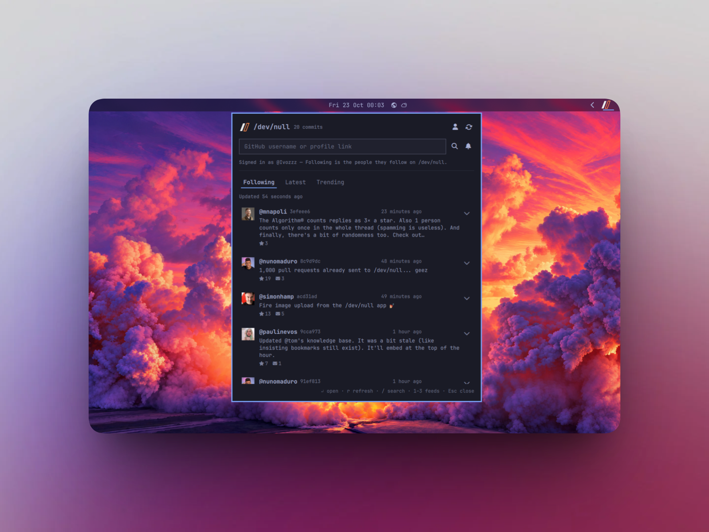

# /dev/null — an Omarchy bar widget for [dev-null.sh](https://dev-null.sh)

Read-only commit feed from [dev-null.sh](https://dev-null.sh), the social
network for developers, in the Omarchy status bar. No account needed, no token,
no write access — and an optional sign-in that turns Following into the site's
real follow graph.

## What it does

- Three feeds, switchable from the panel or with `1` `2` `3` and the left and
  right arrows, named after the site's own log tabs:
  - **Following** — signed out, the merged commit log of the developers you
    watch; signed in, the people you follow on the site itself
  - **Latest** — everything on the site, newest first
  - **Trending** — the site's own ranking
- A bar icon in the Omarchy status-bar style: the two slashes of the
  /dev/null mark, drawn in the same font, size and slot as the volume or
  Bluetooth icons. It takes the accent colour when the feed has arrivals since
  the last refresh, and the urgent colour when a refresh could not be read at
  all. Each feed keeps its own count, so a commit first read on Latest is still
  news on the watchlist; the tooltip carries that count and, for a failed
  refresh, the reason.
- A panel listing the commits: avatar, handle, short hash, age, up to three
  lines of the commit, and its star and reply counts. A row opens on dev-null.sh
  in the browser; middle click opens the author, right click copies the commit
  link, and the chevron expands the row to the whole commit and the first
  replies to it without leaving the panel.
- A status line under the feed tabs: how old the feed is, how many watched users
  failed, and a retry that asks only the ones that did. The line is there even
  while rows are on screen, so a partial refresh cannot pass for a complete one.
- A lookup box: type any GitHub username, or paste a profile link from GitHub or
  dev-null.sh, to see their profile (commit and follower counts) and to add or
  remove them from your watchlist. A link to a repository, or anything else that
  is not a profile, says so instead of doing nothing.
- The watchlist itself as a row of chips: one click opens a profile, the ×
  removes somebody. Until you write a list of your own, the four default names
  are marked as examples. Both the chips and the watch button on a profile go
  away when you sign in, because following is then the site's own graph.
- **Optional sign-in for the real Following feed.** GitHub is the site's only
  way in, and its OAuth callback is pinned to the site, so the widget cannot run
  that flow; it uses the same device approval the dev-null.sh mobile app does.
  The GitHub button in the panel opens an approval page in your browser, the
  site approves a key of the plugin's own for your account once, and every
  request afterwards is signed with it. The panel then reads the site's own
  Following, Latest and Trending through the signed API, and says whose follows
  it is showing.
- **A desktop notification when somebody you watch posts.** It names them,
  carries the first line of the commit, and opens the commit when clicked. One
  notification per batch rather than one per commit, never while the panel is
  open, and only on the Following feed. The bell next to the lookup box is the
  switch: on by default, and clicking it turns it off for good.
- English and Italian catalogs, following Setup > Language like the built-in
  plugins.



## Install

```bash
omarchy plugin add https://github.com/Ivozzz/omarchy-devnull.git --enable
```

The clone lands in `~/.config/omarchy/plugins/io.github.ivozzz.devnull` and stays
a git checkout, so later releases are:

```bash
omarchy plugin update io.github.ivozzz.devnull
```

Already have it in a folder?

```bash
omarchy plugin enable io.github.ivozzz.devnull   # puts it on the bar
omarchy restart shell                            # only if the icon does not appear
```

## Remove

```bash
omarchy plugin remove io.github.ivozzz.devnull
```

That takes the widget off the bar, unloads it from `omarchy-shell`, and deletes
the clone. It writes nowhere else, so there is nothing else to clean up: your
watchlist and feed choice live in the widget's own entry in
`~/.config/omarchy/shell.json`, which goes with the bar entry.

If you signed in, the clone's removal leaves its key, the account file, and the
`devnull://` handler behind — the widget itself deletes them when you press the
account button to sign out. The one thing it cannot delete is the approval on
the site: revoke it at **Settings → Devices** on dev-null.sh (the API has no
route for it).

## Dependencies

- `curl`, for every request the widget makes (see "Where each feed comes from").
  It is run as an argv vector with no shell in between, and its output is parsed
  as data — never executed, never written to a file, never piped into a shell.
- `canberra-gtk-play` (libcanberra, which Omarchy already pulls in with the
  freedesktop sound theme), for the notification sound only, and only while
  `notifySound` is on. Without it the notification still appears, silently.
- `wl-copy` (wl-clipboard, which Omarchy ships with its clipboard plugin), for
  the right-click copy of a commit link. Without it that action does nothing.
- Only for the optional sign-in: `ssh-keygen` (openssh), `od` and `sha256sum`
  (coreutils), `xdg-mime` (xdg-utils), and `update-desktop-database`
  (desktop-file-utils), all run as argv vectors like the rest. Signed out, none
  of them is ever called.
- Nothing else: no package manager, no build step, no installer script, no
  service units, and no sudo or pkexec. `quickshell` and the Omarchy shell plugin
  API are provided by Omarchy itself.

## Where each feed comes from

dev-null.sh publishes a public, read-only JSON API under `/api/v1` with no
authentication:

| Endpoint | Returns |
|---|---|
| `GET /api/v1/users/{username}` | a public profile |
| `GET /api/v1/users/{username}/commits` | that user's commits, newest first, 20 per page |
| `GET /api/v1/users/{username}/commits?replies=1` | that user's replies, same paging — replies only, not merged with the list above |
| `GET /api/v1/commits/{id}` | one commit |

There is no global timeline endpoint and no search, so **Following** is built
from that API: one request per watched user, merged and sorted, and a second
one each when `includeReplies` is on. The site's own `/log/following` is not
used because it answers `302` to the login page, and this plugin has no session
and wants none.

**Latest** and **Trending** have no API endpoint at all. They are read from the
Inertia payload the site already embeds in those two pages — a
`<script type="application/json">` tag whose `props.commits.data` carries the
same commit shape as the API. Only that JSON is read; the surrounding markup is
never parsed, so a redesign of the HTML costs nothing. Two consequences of the
payload carrying less than the API does: the short hash is not in it (those rows
show none), and an avatar hosted on `dev-null.sh` itself rather than on GitHub's
CDN is not loaded.

The API allows 60 requests per minute per IP. A Following refresh costs one
request per watched user — two when replies are included — and runs them one at
a time; the other two cost a single page each. Five minutes and a handful of
users stays well inside it.

The replies to a single commit are not on that API:
`/api/v1/commits/{id}/replies` answers `401` without a signature. They are read
off the commit page itself, whose Inertia payload carries them in a `replies`
prop — three per page, with a cursor for the rest. Expanding a row therefore
costs one request for that page, and the panel shows what it brought while
pointing at the site for the remainder. The page is kept for the visit, so
reopening the same row costs nothing.

Signed in, the picture is simpler: all three feeds come from the site's own
signed API — `GET /api/v1/log/following`, `/latest`, `/trending` — one request
each, and Following is the site's real follow graph rather than the watchlist.
The watchlist, `includeReplies`, the chips and the watch button are not used
while you are signed in; they come back when you sign out.

## Signing in (optional)

[dev-null.sh](https://dev-null.sh) signs people in with GitHub only, and its
OAuth callback is pinned to the site, so a widget cannot run that flow. What it
can use is the device approval the site's own mobile app uses:

1. Click the GitHub button in the panel (top right). The widget makes an SSH key
   of its own, with no passphrase, under
   `$XDG_STATE_HOME/omarchy/devnull/` (usually
   `~/.local/state/omarchy/devnull/`, mode `700`).
2. It writes a small desktop entry for the `devnull://` scheme — a hidden
   handler in `~/.local/share/applications/devnull-callback.desktop`, pointing
   at `bin/devnull-callback` inside this plugin's checkout — registers it with
   `xdg-mime`, and refreshes the desktop database with
   `update-desktop-database`. Both steps matter: `xdg-mime` sets the
   preference, but a browser opens the scheme through the portal, which only
   offers applications the desktop database lists.
3. Your browser opens dev-null.sh's approval page. It names the widget
   ("Omarchy bar") and the key's fingerprint; approve it while signed in to the
   site. The key itself never needs to be on your GitHub account.
4. The site sends a one-time code back to `devnull://`, the handler writes it
   where the panel is polling, and the widget redeems it for the device. The
   account file is written and every feed is refetched, signed.

While the browser is open the GitHub button is a clock, and clicking it cancels:
the key, the handler and the half-finished state are deleted, and you are back
on the watchlist. If the approval does not come back, nothing is kept either.

**What is written where.** The private key (`device.key`), its public half, the
account file (`account.json`), the PKCE verifier, the message it signs
(`sign-feed`/`sign-login` with their `.sig` files), and the callback scratch file
all live in `$XDG_STATE_HOME/omarchy/devnull/` — never in `shell.json`, which
the settings form writes and the whole shell reads. The account file holds the
username, the display name, the key's fingerprint, and when you signed in; the
private key is only ever read by `ssh-keygen`.

**What leaves the machine.** Exactly one thing: the request, signed. Each is
`<timestamp>\n<nonce>\n<METHOD>\n<path>\n<body>` signed with the key
(`ssh-keygen -Y sign`, namespace `devnull-api`), with the timestamp and nonce in
`X-Devnull-Timestamp` and `X-Devnull-Nonce` and the signature in
`X-SSH-Signature`. The signature is built inside the plugin from a fixed
allowlist of paths, so neither a response nor a setting can point it elsewhere.
The key never leaves the state directory; no password and no token is stored
anywhere.

**Signing out**, through the same button, deletes the key, the account file, the
verifier, the handler and the messages, and puts you back on the watchlist — the
feeds go straight back to the public API. The approval on the site is not the
plugin's to delete, since the API has no route for it: revoke it at **Settings →
Devices** on dev-null.sh. If the site ever answers `401` because the approval is
gone, the panel says so and offers the sign-in again instead of reporting an
empty feed.

## Settings

Stored in this widget's entry in `~/.config/omarchy/shell.json`:

| Key | Default | Meaning |
|---|---|---|
| `view` | `following` | `following`, `latest` or `trending` |
| `watch` | `nunomaduro,brendt,paulinevos,mnapoli` | comma-separated GitHub usernames |
| `includeReplies` | `false` | fetch replies as well as top-level commits (a second request per user) |
| `refreshMinutes` | `5` | refresh interval, 1–60 |
| `showAvatars` | `true` | load avatars from GitHub's CDN |
| `notifyNewPosts` | `true` | desktop notification when a watched developer (or, signed in, somebody you follow) posts; the bell in the panel writes this |
| `notifySound` | `true` | play a sound with that notification, through your active sound theme; Do Not Disturb or a snooze mutes it with the notification |

```bash
omarchy bar set io.github.ivozzz.devnull view trending
omarchy bar set io.github.ivozzz.devnull watch nunomaduro,laravel,php
omarchy bar set io.github.ivozzz.devnull refreshMinutes 10
omarchy bar set io.github.ivozzz.devnull notifyNewPosts false
omarchy bar set io.github.ivozzz.devnull notifySound false
omarchy bar get io.github.ivozzz.devnull watch
```

The tabs in the panel and the watch toggle inside it write the same entry.
`watch` and `includeReplies` only apply while you are signed out — signed in,
Following is the site's own follow graph and both are ignored.

## What runs in the background

The widget is alive whether or not the panel is open, and these are the things
that happen without you asking:

- Every `refreshMinutes`, it fetches the current feed — one signed request when
  you are signed in, the watchlist merge or a single log page when you are not.
  Nothing is stored: the feed, and the list of commit ids already counted as
  seen for each feed, live
  in memory for the shell session only. The timer pauses while the panel is
  open, so a refresh cannot reorder the rows under the cursor, and catches up
  on close. Switching feeds in the middle of a fetch throws that answer away
  rather than painting the old feed under the new tab.
- With `notifyNewPosts` on, a refresh that finds new commits from somebody you
  watch — or follow, when signed in — sends one desktop notification. It is
  skipped entirely while the panel is
  open, because then the commits are already on screen, and consecutive
  notifications replace one another instead of stacking up.
- With `notifySound` on as well, that notification is heard: the notification
  service shows a toast and nothing else, so the plugin plays the freedesktop
  `message-new-instant` event through your active sound theme with a second
  command. It is silenced with the toast by Do Not Disturb or a snooze, and
  never plays when `notifyNewPosts` is off.
- A notification names itself `dev-null.sh` rather than borrowing Omarchy's own
  app name. That matters: the notification service lets its own action toasts
  past Do Not Disturb and treats them as throwaway, which is right for "theme
  changed" and wrong for "somebody you follow posted". These take the ordinary
  path — DND silences them, and they stay in the notification history.

To stop all of it, remove the plugin. To stop only the notifications, click the
bell in the panel or:

```bash
omarchy bar set io.github.ivozzz.devnull notifyNewPosts false
```

## Keys and mouse

| | |
|---|---|
| click the icon | open or close the panel |
| middle click the icon | refresh now |
| middle click a row | open the author's profile |
| right click a row | copy the commit link |
| chevron on a row | read the whole commit and its replies in place |
| `1` `2` `3` | Following / Latest / Trending |
| `←` / `→` | previous / next feed |
| `↑` / `↓` | move the row cursor |
| `Enter` | open the selected commit |
| `r` | refresh |
| `/` | jump to the lookup box |
| `Tab` | hand the popup to the next bar panel |
| `Esc` | close |

The same keys are printed along the bottom of the panel. From the lookup box,
`↓` starts walking the feed and `Esc` hands focus back there first — a second
`Esc` closes the panel.

## Privacy and safety

- Only two kinds of URL are ever requested: `https://dev-null.sh/api/v1/users/…`
  for the watchlist, and `https://dev-null.sh/log/latest` or
  `https://dev-null.sh/log/trending` for the other two feeds. Each has its own
  allowlist checked against the whole URL, and anything else produces no command
  at all — the two log URLs come from a fixed table, so no setting can steer
  them.
- Signed in, requests go to the signed API instead: `https://dev-null.sh/api/v1/log/{following,latest,trending}`
  and `/api/v1/devices` for the redemption. These are a fixed table in the
  model, checked before anything is signed, and the browser is only ever opened
  at the site's own `/mobile/authorize` page with parameters the model built.
- Every request is a bounded `curl` (4s connect, 8–12s total, 2–4 MB cap) run
  as an argv vector, never through a shell.
- Reopening the panel cannot spend the rate limit: a refresh more than once a
  minute is skipped unless you ask for it (middle click, `r`, or a tab change).
- Commit text is treated as untrusted wherever it comes from: markup is removed
  rather than escaped, invisible and bidi characters are dropped, strings and
  lists are length capped, and the commit URL handed to the browser is rebuilt
  from the validated username and id instead of taken from the response. That
  last part covers the notifications too, whose body is rendered as styled text
  on purpose — so the text they carry is the same stripped text the panel shows,
  never a raw commit body.
- The notification is sent as an argv vector, and the only command its click
  action can run is the browser, with a commit URL rebuilt the same way.
- Avatars load only from `avatars.githubusercontent.com` and
  `user-images.githubusercontent.com`, and only when `showAvatars` is on.
- Which commits you have already seen is kept in memory for the shell session,
  one list per feed. On disk the widget writes only the settings above, and — if
  you sign in — the key, account and handler files listed under "Signing in",
  all in its own state directory and the applications directory.

## Tests

```bash
node --test tests/*.test.js        # API and page parsing, validation, merge, freshness, catalogs
./tests/qml-smoke.test.sh          # compiles and instantiates both entry points
```

The node suite runs in CI on every push; the QML smoke test needs a running
Quickshell, so it stays local.

Saving a QML file under `~/.config/omarchy/plugins/` reloads plugin code on
save. It has not always taken effect here, so if a change does not show up in
the bar or the panel:

```bash
omarchy restart shell
```

## Layout

```
manifest.json     plugin manifest and the settings schema
BarWidget.qml     the bar icon
DevNullMark.qml   the brand mark, used in the panel header
assets/           that mark, one file per background
Panel.qml         the popup panel
Model.js          API and page parsing, validation, merging — no UI in it
bin/devnull-callback  the devnull:// handler the browser hands the code to
i18n/             en.json, it.json
screenshot.png    the panel shown above, signed in
preview.png       the marketplace's card source
tests/            node and quickshell coverage
```

## Credits and licence

MIT — see [LICENSE](LICENSE).

Built on the Omarchy shell plugin architecture; see [NOTICE](NOTICE) for the
attribution. Not affiliated with or endorsed by dev-null.sh: the plugin only
reads the site's public endpoints.