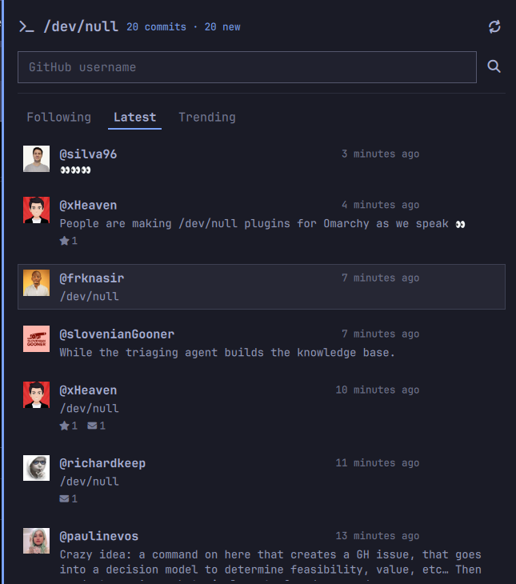

# /dev/null — an Omarchy bar widget for [dev-null.sh](https://dev-null.sh)

Read-only commit feed from [dev-null.sh](https://dev-null.sh), the social
network for developers, in the Omarchy status bar. No account, no token, no
write access.

## What it does

- Three feeds, switchable from the panel or with `1` `2` `3`, named after the
  site's own log tabs:
  - **Following** — the merged commit log of the developers you watch
  - **Latest** — everything on the site, newest first
  - **Trending** — the site's own ranking
- A bar pill showing how many commits are in the current feed. It turns accent
  coloured while something new has arrived since the last refresh.
- A panel listing the commits: avatar, handle, short hash, age, up to three
  lines of the commit, and its star and reply counts. A row opens on dev-null.sh
  in the browser.
- A lookup box: type any GitHub username to see their profile (commit and
  follower counts) and to add or remove them from your watchlist.
- **A desktop notification when somebody you watch posts.** It names them,
  carries the first line of the commit, and opens the commit when clicked. One
  notification per batch rather than one per commit, never while the panel is
  open, and only on the Following feed. The bell next to the lookup box is the
  switch: on by default, and clicking it turns it off for good.
- English and Italian catalogs, following Setup > Language like the built-in
  plugins.



## Install

```bash
omarchy plugin add https://github.com/Ivozzz/omarchy-devnull.git --enable
```

The clone lands in `~/.config/omarchy/plugins/io.github.ivozzz.devnull` and stays
a git checkout, so later releases are:

```bash
omarchy plugin update io.github.ivozzz.devnull
```

Already have it in a folder?

```bash
omarchy plugin enable io.github.ivozzz.devnull   # puts it on the bar
omarchy restart shell                            # only if the pill does not appear
```

## Remove

```bash
omarchy plugin remove io.github.ivozzz.devnull
```

That takes the widget off the bar, unloads it from `omarchy-shell`, and deletes
the clone. It writes nowhere else, so there is nothing else to clean up: your
watchlist and feed choice live in the widget's own entry in
`~/.config/omarchy/shell.json`, which goes with the bar entry.

## Dependencies

- `curl`, for the two read-only endpoints (see "Where each feed comes from"). It
  is run as an argv vector with no shell in between, and its output is parsed as
  data — never executed, never written to a file, never piped into a shell.
- Nothing else: no package manager, no build step, no installer script, no
  service units, and no sudo or pkexec. `quickshell` and the Omarchy shell plugin
  API are provided by Omarchy itself.

## Where each feed comes from

dev-null.sh publishes a public, read-only JSON API under `/api/v1` with no
authentication:

| Endpoint | Returns |
|---|---|
| `GET /api/v1/users/{username}` | a public profile |
| `GET /api/v1/users/{username}/commits` | that user's commits, newest first, 20 per page |
| `GET /api/v1/commits/{id}` | one commit |

There is no global timeline endpoint and no search, so **Following** is built
from that API: one request per watched user, merged and sorted. The site's own
`/log/following` is not used because it answers `302` to the login page, and
this plugin has no session and wants none.

**Latest** and **Trending** have no API endpoint at all. They are read from the
Inertia payload the site already embeds in those two pages — a
`<script type="application/json">` tag whose `props.commits.data` carries the
same commit shape as the API. Only that JSON is read; the surrounding markup is
never parsed, so a redesign of the HTML costs nothing. Two consequences of the
payload carrying less than the API does: the short hash is not in it (those rows
show none), and an avatar hosted on `dev-null.sh` itself rather than on GitHub's
CDN is not loaded.

The API allows 60 requests per minute per IP. A Following refresh costs one
request per watched user and runs them one at a time; the other two cost a
single page each. Five minutes and a handful of users stays well inside it.

## Settings

Stored in this widget's entry in `~/.config/omarchy/shell.json`:

| Key | Default | Meaning |
|---|---|---|
| `view` | `following` | `following`, `latest` or `trending` |
| `watch` | `nunomaduro,brendt,paulinevos,mnapoli` | comma-separated GitHub usernames |
| `includeReplies` | `false` | fetch replies as well as top-level commits |
| `refreshMinutes` | `5` | refresh interval, 1–60 |
| `showAvatars` | `true` | load avatars from GitHub's CDN |
| `notifyNewPosts` | `true` | desktop notification when a watched developer posts; the bell in the panel writes this |

```bash
omarchy bar set io.github.ivozzz.devnull view trending
omarchy bar set io.github.ivozzz.devnull watch nunomaduro,laravel,php
omarchy bar set io.github.ivozzz.devnull refreshMinutes 10
omarchy bar set io.github.ivozzz.devnull notifyNewPosts false
omarchy bar get io.github.ivozzz.devnull watch
```

The tabs in the panel and the watch toggle inside it write the same entry.

## What runs in the background

The widget is alive whether or not the panel is open, and these are the things
that happen without you asking:

- Every `refreshMinutes`, it fetches the current feed. Nothing is stored: the
  feed, and the list of commit ids already counted as seen, live in memory for
  the shell session only.
- With `notifyNewPosts` on, a refresh that finds new commits from somebody you
  watch sends one desktop notification. It is skipped entirely while the panel
  is open, because then the commits are already on screen, and consecutive
  notifications replace one another instead of stacking up.
- A notification names itself `dev-null.sh` rather than borrowing Omarchy's own
  app name. That matters: the notification service lets its own action toasts
  past Do Not Disturb and treats them as throwaway, which is right for "theme
  changed" and wrong for "somebody you follow posted". These take the ordinary
  path — DND silences them, and they stay in the notification history.

To stop all of it, remove the plugin. To stop only the notifications, click the
bell in the panel or:

```bash
omarchy bar set io.github.ivozzz.devnull notifyNewPosts false
```

## Keys and mouse

| | |
|---|---|
| click the pill | open or close the panel |
| middle click the pill | refresh now |
| `1` `2` `3` | Following / Latest / Trending |
| `↑` / `↓` | move the row cursor |
| `Enter` | open the selected commit |
| `r` | refresh |
| `/` | jump to the lookup box |
| `Tab` | hand the popup to the next bar panel |
| `Esc` | close |

## Privacy and safety

- Only two kinds of URL are ever requested: `https://dev-null.sh/api/v1/users/…`
  for the watchlist, and `https://dev-null.sh/log/latest` or
  `https://dev-null.sh/log/trending` for the other two feeds. Each has its own
  allowlist checked against the whole URL, and anything else produces no command
  at all — the two log URLs come from a fixed table, so no setting can steer
  them.
- Every request is a bounded `curl` (4s connect, 8–12s total, 2–4 MB cap) run
  as an argv vector, never through a shell.
- Reopening the panel cannot spend the rate limit: a refresh more than once a
  minute is skipped unless you ask for it (middle click, `r`, or a tab change).
- Commit text is treated as untrusted wherever it comes from: markup is removed
  rather than escaped, invisible and bidi characters are dropped, strings and
  lists are length capped, and the commit URL handed to the browser is rebuilt
  from the validated username and id instead of taken from the response. That
  last part covers the notifications too, whose body is rendered as styled text
  on purpose — so the text they carry is the same stripped text the panel shows,
  never a raw commit body.
- The notification is sent as an argv vector, and the only command its click
  action can run is the browser, with a commit URL rebuilt the same way.
- Avatars load only from `avatars.githubusercontent.com` and
  `user-images.githubusercontent.com`, and only when `showAvatars` is on.
- Which commits you have already seen is kept in memory for the shell session.
  Nothing is written to disk beyond the settings above.

## Tests

```bash
node --test tests/model.test.js    # API and page parsing, validation, merge, freshness, notifications
./tests/qml-smoke.test.sh          # compiles and instantiates both entry points
```

Saving a QML file under `~/.config/omarchy/plugins/` reloads plugin code on
save. It has not always taken effect here, so if a change does not show up in
the bar or the panel:

```bash
omarchy restart shell
```

## Layout

```
manifest.json     plugin manifest and the settings schema
BarWidget.qml     the bar pill
Panel.qml         the popup panel
Model.js          API and page parsing, validation, merging — no UI in it
i18n/             en.json, it.json
preview.png      the screenshot above, and the marketplace's card source
tests/            node and quickshell coverage
```

## Credits and licence

MIT — see [LICENSE](LICENSE).

Built on the Omarchy shell plugin architecture; see [NOTICE](NOTICE) for the
attribution. Not affiliated with or endorsed by dev-null.sh: the plugin only
reads the site's public endpoints.